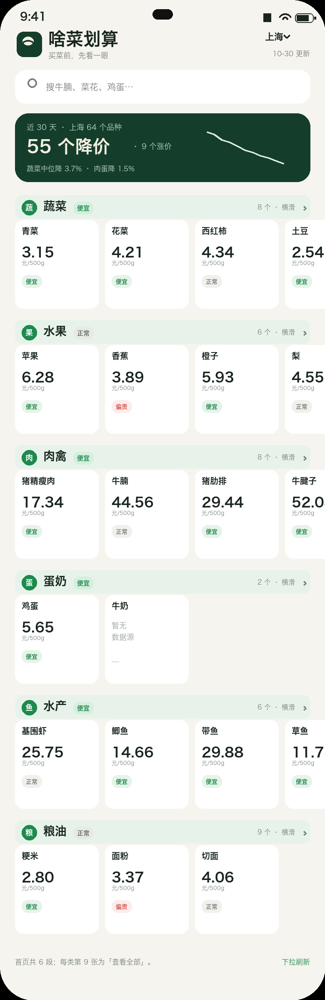

# 啥菜划算

买菜前打开 10 秒，知道今天这个价贵不贵、大概该花多少钱、周围哪里更便宜。

支持 **成都（默认）**、上海、北京三个城市。

一个 Android 小工具，面向不熟悉菜价行情的人。数据全部来自官方公开的每日价格监测，不抓取电商平台价格。



## 功能

- **首页**：蔬菜 / 水果 / 肉禽 / 蛋奶 / 水产 / 粮油，纵向 6 段，每段横向滑 8 个品种，第 9 张“查看全部”。
- **分类页**：按食材、部位、品种查看；上海显示 30 天价格区间条，北京显示农贸 / 超市 / 批发三个参考价。
- **详情页**（上海）：今日参考价、便宜 / 正常 / 偏贵标签、30 天价格带、每日均价曲线、最便宜 3 家店、便宜入手价提醒。
- **详情页**（北京）：农贸均价、超市均价、新发地批发参考，30 天批发曲线，价格说明与数据来源。
- **比价**：一键拉起永辉生活、叮咚买菜、七鲜、盒马、小象超市、多多买菜，并复制食材名；未安装只提示。
- **小红书**：直接尝试拉起搜索“牛腩 价格”。
- **搜索**：按食材名搜。
- **下拉刷新**：每天首次启动下拉，拉取最新官方数据。无服务器、无后台任务。

## 数据来源

| 城市 | 来源 | 口径 | 更新 |
|---|---|---|---|
| 成都（默认） | [成都市城市居民生活价格服务公益平台](https://www.cdprice.cn/) | 全市监测点均价 | 每日 |
| 上海 | [上海市发改委 · 价格监管动态](https://fgw.sh.gov.cn/fgw_jgjgdt/) 每日 XLS | 逐店零售价 | 每个工作日 |
| 北京 | [北京价格 · 每日价格](https://www.beijingprice.cn/mrjg/) JSON | 全市农贸 / 超市均价 | 每日 |
| 北京 30 天 | [新发地](http://www.xinfadi.com.cn/priceDetail.html) | 批发价 | 每日 |

- 单位统一 **元/500g**；食用油按原包装单位。
- 成都有 38 个品种的全市均价与近 7 天走势。
- 上海有 50+ 个监测点逐店价格，所以能给出“今天最便宜的 3 家店”。
- 北京每日 JSON 只有全市均价，没有门店明细，故不列店名。
- 牛奶：上海、北京的官方监测数据中没有乳制品价格，显示“牛奶相关信息暂无数据源”；成都有真实牛奶价格。

## 价格怎么算

- 今日参考价：当日所有监测点均价。
- 常见价：30 天所有监测点的 P50。
- 便宜入手价：30 天所有监测点的 P20。
- 便宜 / 正常 / 偏贵：今日均价在 30 天每日均价序列中的位置（≤P30 / P30~P70 / ≥P70）。

界面上不出现“分位数”“环比”等术语。

## 安装

从 [apk/shacaihuasuan-v2.1.0.apk](apk/shacaihuasuan-v2.1.0.apk) 下载安装。

- 最低 Android 8.0
- 已在小米 15 Pro / Android 17 上测试
- 安装包使用自签名，非商店版本；小米如拦截，选择“允许安装未知应用”

## 自己编译

需要 JDK 17 和 Android SDK（compileSdk 34）。

```bash
# 1. 修改 local.properties 里的 sdk.dir
# 2. 编译
./gradlew :app:assembleRelease
```

没有 `gradlew` 时，用本机 Gradle 8.7：

```bash
gradle :app:assembleRelease
```

产出：`app/build/outputs/apk/release/app-release.apk`

### 签名

`app/build.gradle` 里默认引用了一个调试签名路径。自己编译时改成你的 keystore：

```gradle
signingConfigs {
    release {
        storeFile file("/your/path/debug.keystore")
        storePassword "android"
        keyAlias "androiddebugkey"
        keyPassword "android"
    }
}
```

## 项目结构

```
app/src/main/java/com/shacaihuasuan/
├── MainActivity.java          首页：6 段纵向 + 横向滑动
├── CategoryActivity.java      分类页
├── DetailActivity.java        详情页（上海 / 北京 / 牛奶三种）
├── SearchActivity.java        搜索
├── AboutActivity.java         数据说明
├── PlatformDialog.java        6 个平台半屏
├── Jump.java                  拉起 App + 复制关键词
├── Ui.java                    统一配色 / 间距 / 组件
├── data/
│   ├── Model.java             数据模型
│   ├── JsonData.java          解析内置 JSON
│   ├── Repo.java              数据仓库、刷新、合并
│   ├── XlsParser.java         解析上海 XLS
│   ├── ShanghaiSource.java    抓上海最新 XLS
│   ├── BeijingSource.java     抓北京每日 JSON
│   ├── ChengduSource.java     抓成都品种价格与 7 天序列
│   └── Network.java           HTTP
└── widget/
    ├── BandView.java          30 天价格带
    └── LineView.java          趋势曲线
```

## 已知限制

- 成都历史曲线为 7 天（平台只提供 7 天）。
- 北京新发地 30 天曲线目前是内置快照，零售价可下拉刷新。
- 平台 App 包名可能随版本变化；如果已安装却提示“暂未安装”，改 `PlatformDialog.java` 里的包名。
- 小红书搜索 scheme 依赖 App 版本，失败会回退到打开首页 + 复制关键词。
- 价格仅供参考，以实际结算为准。

## 许可

仅供个人学习与自用。数据版权归原发布机构所有。
